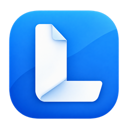

# Lee’s PDF

### 看清每一页，编辑每一个细节。

本地优先的 PDF 阅读与编辑工具。
在 Windows 与 Mac 上整理文档、编辑内容和处理扫描件。

[下载版本](https://github.com/lyq2010/lee-releases/releases?q=%22Lee%E2%80%99s+PDF%22&expanded=true) · [更新记录](https://github.com/lyq2010/lee-releases/releases?q=%22Lee%E2%80%99s+PDF%22&expanded=true) · [反馈问题](https://github.com/lyq2010/lee-releases/issues)

---

## 从阅读，到完成文档

- **专注阅读** — 连续与分页布局、文本选择、搜索、书签和目录索引。
- **直接编辑** — 修改原文与文本框，添加文字、图片和链接。
- **整理页面** — 旋转、裁剪、排序、提取、合并与拆分；PDF 可与支持的图片格式混合合并。
- **审阅与标记** — 批注、印章、水印、页眉页脚与 Bates 编号。

文档在本机处理，保存时选择覆盖原文件或另存为。

## 扫描件与日常处理

| 功能 | 用途 |
| --- | --- |
| 扫描 OCR | 识别扫描文字、校正结果并输出可搜索 PDF |
| 扫描编辑与增强 | 编辑扫描文字，纠偏、降噪、去背景及调整透视 |
| 创建与导出 | 从支持的本地来源创建 PDF，导出文字、图片及办公格式 |
| 压缩优化 | 分析资源占用，调整图片与资源，预览压缩结果 |
| 基础表单 | 填写已有 AcroForm 并保存 |
| 保护与脱敏 | 密码或接收者证书保护，永久移除选定敏感内容 |
| 打印 | 页面范围、缩放、海报、多页与小册子预览及系统打印 |

OCR、字体拟合和办公格式转换会受原稿、字体及版面影响，请检查输出。Office 来源转换需要本机 Microsoft Office 或主动配置的自托管服务。基础表单不运行脚本，不提供字段设计或复杂计算；不提供数字证书签名创建。

## 选择你的版本

| 平台 | 系统要求 | 安装包 | 更新记录 |
| --- | --- | --- | --- |
| Windows | Windows 11 24H2+、x64 | `lees-pdf-*-windows-x86_64-setup.exe` | [公开发行版](https://github.com/lyq2010/lee-releases/releases?q=%22Lee%E2%80%99s+PDF%22&expanded=true) |
| Mac | macOS 26+、Apple Silicon | `lees-pdf-*-darwin-aarch64.dmg` | [公开发行版](https://github.com/lyq2010/lee-releases/releases?q=%22Lee%E2%80%99s+PDF%22&expanded=true) |

### Windows

1. 在产品发行列表下载 `lees-pdf-*-windows-x86_64-setup.exe`。
2. 核对同一发行版的 SHA-256 和公钥证书；自签证书的信任安装按 [Tauri 官方说明](https://v2.tauri.app/distribute/sign/windows/)执行，安装与更新需要系统认可该发行证书。
3. 运行安装程序，按提示完成安装。
4. 从开始菜单打开应用，选择或拖入文档；设置中可打开系统默认 PDF 应用选项。

Windows 使用自签证书签名；系统可能显示首次下载或运行提示，证书身份与 SHA-256 以同一发行版提供的材料为准。安装不会主动将 PDF 默认查看器改为 Lee’s PDF。

### Mac

1. 下载并打开 `lees-pdf-*-darwin-aarch64.dmg`，将应用拖入「应用程序」。
2. 首次打开若被系统阻止，前往「系统设置 → 隐私与安全性」确认允许。
3. 打开文档，使用工作台中的阅读、编辑与页面工具。

Mac 版采用 ad-hoc 签名，不使用 Developer ID 或 Apple 公证。最终包实际效果和设备打印结果请在自己的系统上确认。

## 文件与更新由你掌握

PDF 正文在本机处理。本地操作失败不会自动上传文件；只有主动选择远端处理目标时才使用对应服务。严格离线模式约束相关网络访问。

应用通过 COS 主源与 R2 备用源获取更新，校验签名清单、版本、大小及 SHA-256。版本清单中的资产使用不可变路径；下载入口按产品筛选发行记录，不使用整个仓库的 Latest 标记。

永久脱敏会移除底层内容，执行前请检查标记；输出保存后，请重新打开并确认内容。反馈时不要上传私人原稿、密码、证书私钥或令牌。

## 反馈与许可

通过 [Issues](https://github.com/lyq2010/lee-releases/issues) 提交平台、应用版本、系统版本、复现步骤及脱敏样例。

本项目闭源发行，保留所有权利，不提供项目源码。第三方组件遵循各自许可证，归属与分发材料随对应发行版提供。

---

[返回 Lee Releases](../../README.md)
